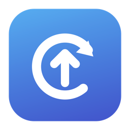
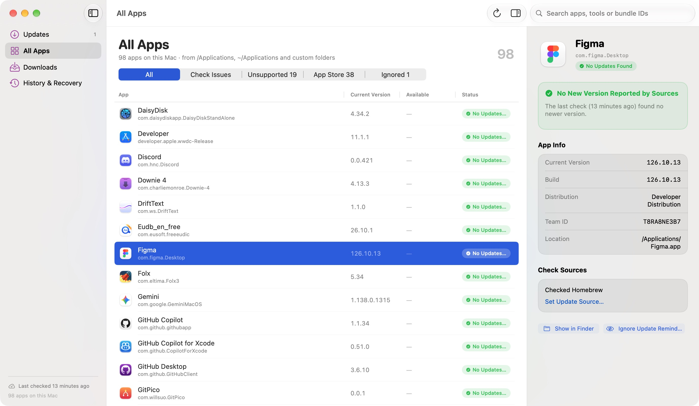
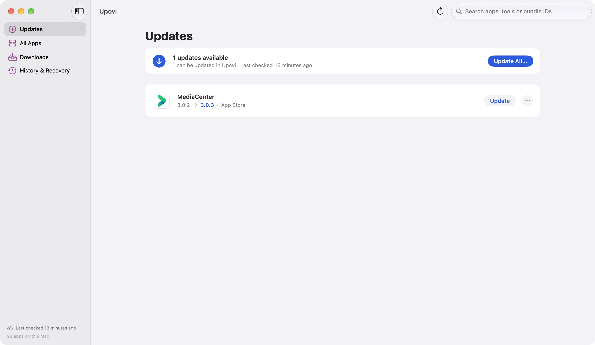
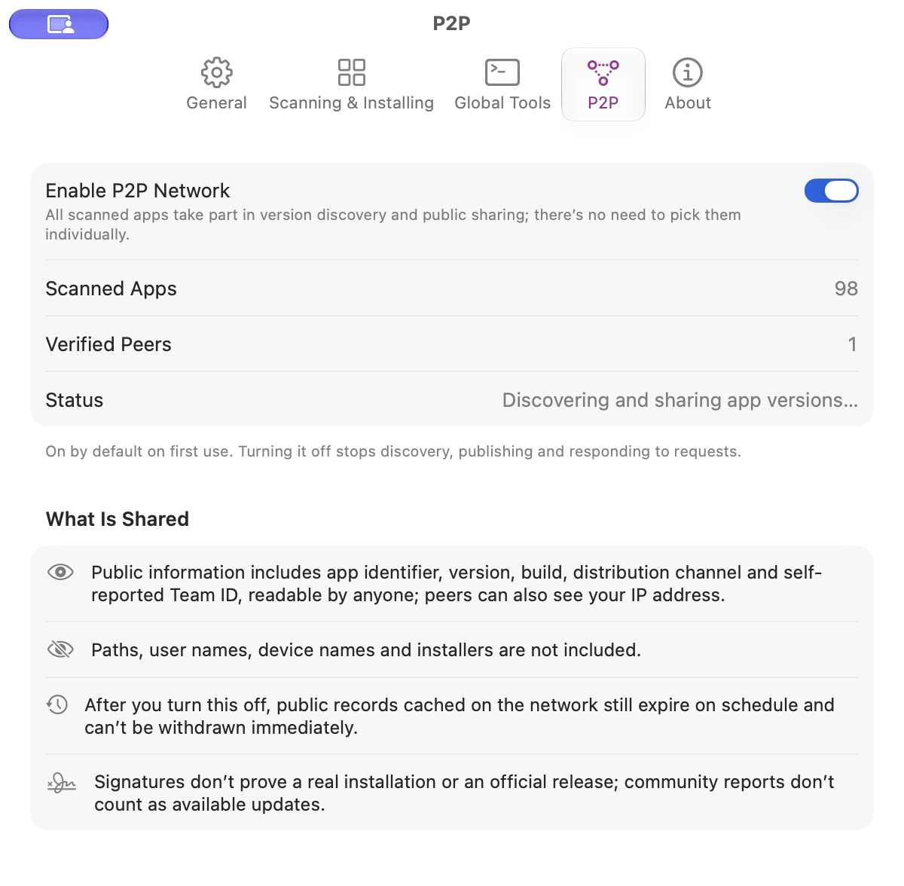

  

<h1 align="center">Upovi</h1>

<strong>Find app updates. See where they come from. Update on your terms.</strong>

  A free, open-source MacUpdater alternative for macOS, built with SwiftUI. 
  Check your apps in one place, install supported updates, and discover version leads through P2P.

  <a href="https://github.com/WillSuo-Github/Upovi/releases/latest"><strong>Download for Mac</strong></a> ·
  <a href="#what-you-can-do">Features</a> ·
  <a href="#public-community-discovery">P2P discovery</a> ·
  <a href="https://github.com/WillSuo-Github/Upovi/issues">Feedback</a> ·
  <a href="README.zh-CN.md">简体中文</a>

macOS 14+ · Apple Silicon & Intel · MIT licensed · Experimental preview

<em>Your app library, installed versions, and update sources in a native Mac interface.</em>

## Why Upovi?

Keeping apps current often means opening several different updaters. Upovi brings supported developer feeds, Homebrew, GitHub releases and Mac App Store apps into one view, so you can see what needs attention and decide what to update.

It also explores a different way to discover versions: Macs can share app version metadata over a public P2P network. A community report can point to a version worth investigating; supported update sources and installation checks still determine what Upovi can install.

**Upovi is still early.** Coverage and update detection have gaps, and some apps require their own updater. If you try it, reports of missed apps, incorrect versions and failed updates are especially helpful.

## What you can do

- **Check your app library at once.** Scan `/Applications`, `~/Applications` and extra folders you choose. Filter by update status, source coverage or App Store distribution, and inspect each app’s version and source.
- **Update individually or in a batch.** Review the proposed changes before installation. Supported app updates can run concurrently, with per-app progress and results; administrator and App Store installation steps are serialized. Failed items can be retried.
- **Keep control of reminders.** Skip a specific version, postpone a reminder, or ignore an app. Optional scheduled checks, notifications and a menu bar entry help you keep up between manual checks.
- **Manage downloads and recovery.** Follow transfers in the download center, pause or resume supported downloads, and inspect installation history. Eligible application replacements retain the previous main app for recovery.
- **Include your global developer tools.** Opt into checks for Homebrew formulae, global npm/pnpm packages, uv tools, pipx, Cargo and Rust toolchains. Outdated packages appear alongside apps; project dependencies and lock files stay unchanged.
- **Discover community version leads.** P2P shares version metadata and finds public reports without an Upovi account or central discovery service. See [what is shared](#public-community-discovery) before participating.

<strong>See the Updates screen</strong>

Actual application screenshots. The apps and available updates will vary on your Mac.

## Where updates come from

| Source | What Upovi supports |
| --- | --- |
| **Developer feeds (Sparkle)** | Reads supported appcasts for versions, release notes and eligible downloads. |
| **Homebrew casks** | Matches desktop apps through declared bundle identifiers and curated identity mappings. You do not need Homebrew installed to check its public app catalog. |
| **GitHub releases** | Checks supported repositories and release assets. You can assign an official repository to an app. |
| **Mac App Store** | Checks supported installations and offers in-app updates through Apple’s services. The owning Apple Account and native authentication may be required. |
| **Custom sources** | Assign an HTTPS appcast or official GitHub repository from an app’s detail panel. |
| **Global package managers** | Uses your existing managers for supported global tools. Each source is off by default and enabled separately in Settings → Global Tools. |

Detection and installation are separate: an app may have a known newer version but still need its official installer or built-in updater. Upovi shows unsupported sources and failed checks separately; an empty update list does not guarantee every app is current.

## Install

1. **[Download the latest preview](https://github.com/WillSuo-Github/Upovi/releases/latest)** and open the ZIP.
2. Move **Upovi.app** to **Applications**, then open it.
3. Upovi scans your apps and checks supported sources on launch. Review available updates before choosing **Update** or **Update All…**.

The published preview is a Developer ID–signed, Apple-notarized universal app for **macOS 14 or later**, on **Apple Silicon and Intel**. End users do not need Xcode, Python or Homebrew to run it. Individual global-tool integrations require their existing package managers.

**Check your P2P preference:** on a fresh installation, public version discovery and sharing are **on by default** for all scanned apps. You can turn them off in **Settings → P2P**. Periodic update checks and global-tool integrations have separate settings.

Upovi’s own updates use Sparkle. Release assets include the archive checksum, source revision and validation results; the [release page](https://github.com/WillSuo-Github/Upovi/releases/latest) is the source of truth for the current downloadable build.

## Public community discovery

What if another Mac has already seen a version your usual sources have missed? Upovi’s experimental P2P discovery lets Macs exchange app version observations using the BitTorrent DHT, without invitations, accounts or an Upovi relay.

**P2P exchanges version metadata. App installers come from update sources.** A peer report never supplies a download URL, authorizes installation, increases the available-update count or triggers an update notification. Upovi checks configured sources independently; matching version/build information can be labeled **Source matches**.

  

### What participation means

- **One switch covers all scanned apps.** On a fresh installation it defaults on. Existing off choices and legacy app-specific scopes migrate conservatively to off. Turn it off in Settings → P2P to stop discovery, publication and responses.
- **Version reports are public.** They contain app identifiers, versions/builds, distribution channels, self-reported developer Team IDs, observation times and expiry. Paths, usernames, device names and app binaries are excluded.
- **Peers can see your IP address.** Records are unencrypted and activity can be correlated. Previously shared records cannot be recalled immediately; they expire within 24 hours and may disappear sooner.
- **Community reports are unverified leads.** A signature identifies a publisher key, not an official release or an independent person. Discovery is best effort, needs working outbound UDP, and does not prevent malicious reports or coordinated interference.

Read the [participation guide](docs/GLOBAL-P2P.md), [community trust rules](docs/COMMUNITY-TRUST.md) and [protocol](docs/P2P-PROTOCOL.md) for the full behavior and limitations.

## Installation checks and recovery

Before replacing an eligible app, Upovi checks the download through a supported archive-proof or reviewed official-origin route, then verifies application identity, developer signatures, the selected version/build, compatibility and Gatekeeper acceptance. Installation requires confirmation. Apps or packages that cannot satisfy the supported checks use the official/manual workflow.

Eligible replacements retain the previous **main application bundle**, with records in **History & Recovery**. That backup does not roll back documents, app data, package scripts, drivers or background services. App Store updates and global package-manager updates do not offer Upovi app-backup recovery.

See [download trust](docs/UPDATE-SOURCE-TRUST.md), [administrator installation](docs/ADMINISTRATOR-INSTALLATION.md), [App Store support](docs/APP-STORE-UPDATES.md) and [download recovery](docs/DOWNLOAD-RESUME-AND-CLEANUP.md).

## Help improve Upovi

Trying it with your own set of apps is one of the most useful ways to help. **[Open an issue](https://github.com/WillSuo-Github/Upovi/issues)** for a missed update, incorrect version, unsupported app or installation failure. Include your macOS version, Upovi build, affected app/version and what you expected to happen.

You can preview and export a local diagnostic report from Upovi. Review it before sharing and include only what is needed; avoid posting raw logs, private inventories or credentials. See [diagnostics](docs/DIAGNOSTICS-AND-SOURCES.md).

Code, source mappings and translation improvements are welcome too. Start with [CONTRIBUTING.md](CONTRIBUTING.md). For security issues, follow [SECURITY.md](SECURITY.md).

## Build from source

Open **Upovi.xcodeproj** in **Xcode 16 or newer**, select **Upovi → My Mac**, and press **⌘R**. Use **⌘U** to run tests. The checked-in project opens directly; XcodeGen is only needed when regenerating it from `project.yml`.

First-time dependency resolution and the pinned Store bridge download require network access. See the [contributor guide](CONTRIBUTING.md) and [Xcode project guide](docs/XCODE-PROJECT.md) for command-line builds, targets and validation workflows.

## Further reading

| Topic | Documentation |
| --- | --- |
| Current readiness, known gaps and release evidence | [Release readiness](docs/RELEASE-READINESS.md) · [Validation](docs/VALIDATION.md) |
| Source coverage and refresh behavior | [Source reliability](docs/SOURCE-REFRESH-AND-RELIABILITY.md) · [Diagnostics](docs/DIAGNOSTICS-AND-SOURCES.md) |
| Global tools and package-manager scope | [Global tool updates](docs/GLOBAL-TOOL-UPDATES.md) |
| Downloads, retries and interrupted work | [Download center](docs/DOWNLOAD-CENTER-AND-ACCEPTANCE.md) · [Resume and cleanup](docs/DOWNLOAD-RESUME-AND-CLEANUP.md) |
| Contributing, build numbering and distribution | [Contributor guide](CONTRIBUTING.md) · [Versioning rules](AGENTS.md) · [Release metadata tool](script/release_metadata.py) |

## License

[MIT](LICENSE). Third-party components and licenses are listed in [THIRD-PARTY-NOTICES.md](THIRD-PARTY-NOTICES.md).
