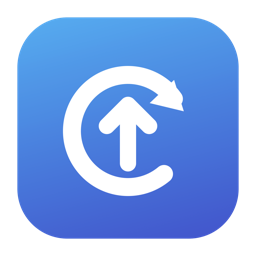
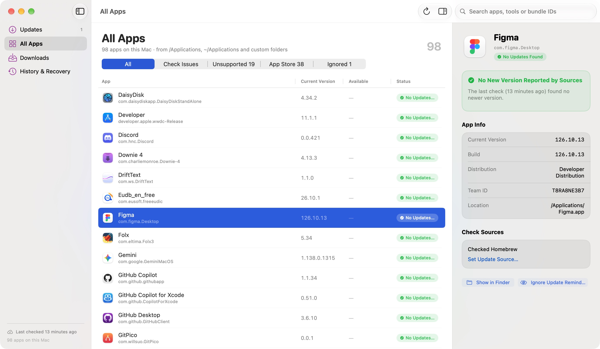
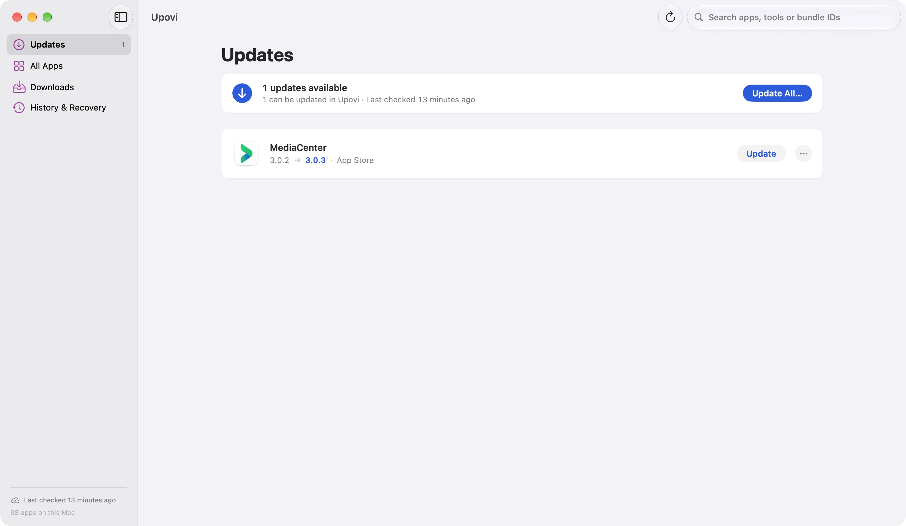
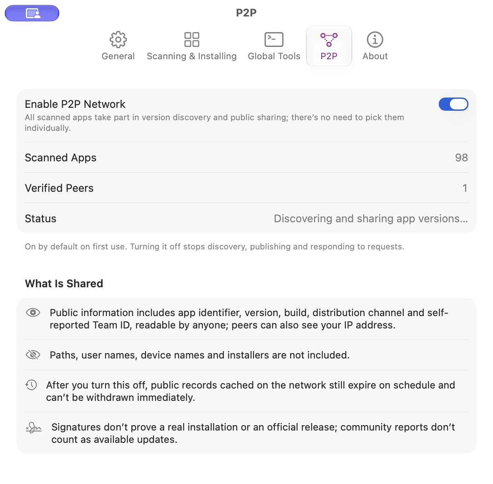

  

<h1 align="center">Upovi</h1>

<strong>发现应用更新，看清更新来源，由你决定何时安装。</strong>

  源码可见、非商用免费的 macOS 应用更新工具，尝试成为 MacUpdater 的替代选择。 
  使用 SwiftUI 构建，集中检查应用版本、安装支持的更新，并通过 P2P 发现社区版本线索。

  <a href="https://github.com/WillSuo-Github/Upovi/releases/latest"><strong>下载 Mac 版</strong></a> ·
  <a href="#你可以用它做什么">功能介绍</a> ·
  <a href="#p2p-社区版本发现">P2P 发现</a> ·
  <a href="https://github.com/WillSuo-Github/Upovi/issues">反馈问题</a> ·
  <a href="README.md">English</a>

macOS 14+ · Apple Silicon 与 Intel · 非商用许可 · 实验性预览版

<em>在原生 Mac 界面中查看应用版本、更新状态和来源。应用会跟随系统语言显示。</em>

## 为什么做 Upovi？

检查应用更新，往往意味着逐个打开软件、查看菜单，或者在多个更新工具之间切换。Upovi 将支持的开发者更新源、Homebrew、GitHub Releases 和 Mac App Store 应用整合到一个窗口，让你集中查看，再决定更新哪些软件。

它也在探索一种不同的版本发现方式：Mac 之间通过公开 P2P 网络共享应用版本信息。社区报告可以帮助发现值得进一步检查的新版本；实际可安装的更新仍由支持的更新来源和安装验证决定。

**项目还在早期阶段。** 应用覆盖、版本判断和更新流程仍有不完善的地方，部分软件需要使用官方安装器或内置更新。欢迎试用，也欢迎告诉我们哪些应用漏检、版本不对，或者更新失败了。

## 你可以用它做什么

- **集中检查应用。** 扫描 `/Applications`、`~/Applications` 和你指定的其他目录，按更新状态、来源支持情况或 App Store 分类筛选，并查看应用详情。
- **单独更新或批量更新。** 安装前先确认更新内容。支持的应用更新可以并发执行，每项都有进度和结果；管理员安装与 App Store 安装步骤会串行处理，失败项可以重试。
- **自己控制提醒。** 跳过指定版本、推迟提醒，或忽略某个应用；也可以启用定时检查、通知和菜单栏入口。
- **管理下载和恢复。** 在下载中心查看任务，暂停或继续支持的下载，在历史记录中查看安装结果。符合条件的应用替换会保留旧的主应用副本，方便恢复。
- **顺手更新全局开发工具。** 按需启用 Homebrew Formula、全局 npm/pnpm 包、uv tools、pipx、Cargo 和 Rust 工具链。待更新的包与应用出现在同一列表，项目依赖和锁文件不会被修改。
- **通过社区发现版本线索。** P2P 无需 Upovi 账号或中心发现服务即可共享版本信息。参与前，请了解[公开共享的内容](#p2p-社区版本发现)。

<strong>查看「更新」页面截图</strong>

以上为实际应用截图。你的应用列表和可用更新会因本机安装情况而不同。

## 支持哪些更新来源？

| 来源 | 支持范围 |
| --- | --- |
| **开发者更新源（Sparkle）** | 读取支持的 appcast，获取版本、更新说明和符合条件的下载。 |
| **Homebrew Cask** | 通过声明的 Bundle ID 和维护的身份映射匹配桌面应用。查询公开应用目录无需安装 Homebrew。 |
| **GitHub Releases** | 检查支持的仓库与发布附件，也可以手动为应用指定官方仓库。 |
| **Mac App Store** | 检查支持的安装，并通过 Apple 服务在 Upovi 内更新；可能需要拥有该应用的 Apple 账号及系统认证。 |
| **自定义来源** | 在应用详情中指定 HTTPS appcast 或官方 GitHub 仓库。 |
| **全局包管理器** | 调用本机已有的管理器检查、更新支持的全局工具。在「设置 → 全局工具」中逐项启用，默认全部关闭。 |

**发现更新与能够安装更新是两回事。** 即使发现了新版本，部分应用仍需使用官方安装器或自身更新功能。Upovi 会区分不支持的来源和检查失败；更新列表为空不代表所有应用都已是最新版。

## 下载与安装

1. **[下载最新预览版](https://github.com/WillSuo-Github/Upovi/releases/latest)**，解压 ZIP。
2. 将 **Upovi.app** 移到「应用程序」，然后打开。
3. Upovi 启动后会扫描应用并检查支持的来源。查看结果，再选择单项「更新」或「全部更新…」。

已发布的预览版经过 Developer ID 签名和 Apple 公证，使用通用二进制，支持 **macOS 14 及以上的 Apple Silicon 与 Intel Mac**。运行 Upovi 无需安装 Xcode、Python 或 Homebrew；使用各项全局工具集成时，需要已有的对应包管理器。

**请留意 P2P 设置：全新安装默认开启公开版本发现与共享，覆盖所有扫描到的应用。** 可在「设置 → P2P」中关闭。定时更新检查和全局工具集成有独立设置。

Upovi 自身使用 Sparkle 更新。发布附件包含安装包校验值、源码修订和验证结果；当前可下载的构建以 [Releases 页面](https://github.com/WillSuo-Github/Upovi/releases/latest)为准。

## P2P 社区版本发现

如果另一台 Mac 已经见到了更新版本，能不能让你的 Mac 也知道？Upovi 的实验性 P2P 功能通过 BitTorrent DHT 交换应用版本观察记录，无需邀请、账号或 Upovi 中继服务器。

**P2P 交换版本信息，安装包来自更新来源。** 社区报告不会提供下载地址、授权安装、增加可用更新数量或触发更新通知。Upovi 会独立检查配置的来源；版本和构建号吻合时，可以标记为「来源吻合」。

  

### 参与前需要了解

- **一个开关覆盖所有扫描到的应用。** 全新安装默认开启；已有的关闭选择，以及旧版按应用选择的范围，会保守迁移为关闭。在「设置 → P2P」关闭后，会停止发现、发布和响应请求。
- **版本记录是公开的。** 包含应用标识、版本与构建号、分发渠道、自报的开发者 Team ID、观察时间和过期时间；不包含路径、用户名、设备名或应用安装包。
- **其他节点可以看到你的 IP 地址。** 记录未加密，网络活动可能被关联。已共享的记录不能立即撤回，最长在 24 小时内过期，也可能更早消失。
- **社区报告仍是未经核实的线索。** 签名只能识别发布密钥，不能证明官方发布或独立用户身份。发现依赖可用的出站 UDP 和网络记录，也无法杜绝恶意报告或协同干扰。

完整说明见[参与指南](docs/GLOBAL-P2P.md)、[社区信任规则](docs/COMMUNITY-TRUST.md)和[协议文档](docs/P2P-PROTOCOL.md)。

## 安装验证与恢复

替换符合条件的应用前，Upovi 会通过支持的安装包校验或经审核的官方来源路径检查下载，再验证应用身份、开发者签名、选定的版本与构建号、兼容性及 Gatekeeper 接受情况。安装需要确认；无法满足支持条件的应用或安装包会转向官方或手动更新流程。

符合条件的替换会保留旧的**主应用包**，可在「历史与恢复」中查看。这不等于回滚文稿、应用数据、安装脚本、驱动或后台服务。App Store 更新和全局包管理器更新不提供 Upovi 应用备份恢复。

详见[下载信任规则](docs/UPDATE-SOURCE-TRUST.md)、[管理员安装](docs/ADMINISTRATOR-INSTALLATION.md)、[App Store 支持](docs/APP-STORE-UPDATES.md)和[下载恢复](docs/DOWNLOAD-RESUME-AND-CLEANUP.md)。

## 一起改进 Upovi

用你自己的应用列表试一试，就是很有价值的帮助。发现漏检、错误版本、不支持的应用或安装失败，欢迎**[提交 Issue](https://github.com/WillSuo-Github/Upovi/issues)**，附上 macOS 版本、Upovi 构建号、受影响的应用版本和预期行为。

Upovi 可以预览和导出本地诊断报告。分享前请先检查，只提供定位问题必需的信息，避免公开原始日志、私人应用清单或凭据。参见[诊断说明](docs/DIAGNOSTICS-AND-SOURCES.md)。

也欢迎贡献代码、来源映射和翻译改进。开发贡献见 [CONTRIBUTING.md](CONTRIBUTING.md)，安全问题请按照 [SECURITY.md](SECURITY.md) 报告。

## 从源码构建

使用 **Xcode 16 或更新版本**打开 **Upovi.xcodeproj**，选择 **Upovi → My Mac**，按 **⌘R** 运行，按 **⌘U** 测试。仓库内的工程可直接打开；只有从 `project.yml` 重新生成工程时才需要 XcodeGen。

首次解析依赖和下载固定版本的 Store bridge 需要联网。命令行构建、目标配置和验证流程见[贡献指南](CONTRIBUTING.md)与 [Xcode 工程说明](docs/XCODE-PROJECT.md)。

## 更多文档

| 主题 | 文档 |
| --- | --- |
| 当前完成情况、已知限制与发布证据 | [发布就绪情况](docs/RELEASE-READINESS.md) · [验证记录](docs/VALIDATION.md) |
| 来源覆盖与刷新行为 | [来源可靠性](docs/SOURCE-REFRESH-AND-RELIABILITY.md) · [诊断](docs/DIAGNOSTICS-AND-SOURCES.md) |
| 全局工具与包管理器范围 | [全局工具更新](docs/GLOBAL-TOOL-UPDATES.md) |
| 下载、重试与中断处理 | [下载中心](docs/DOWNLOAD-CENTER-AND-ACCEPTANCE.md) · [续传与清理](docs/DOWNLOAD-RESUME-AND-CLEANUP.md) |
| 开发贡献、构建编号与分发 | [贡献指南](CONTRIBUTING.md) · [版本规则](AGENTS.md) · [发布元数据工具](script/release_metadata.py) |

## 许可

采用 [PolyForm Noncommercial License 1.0.0](LICENSE)。源码可见，允许在该许可证规定的用途下免费使用、修改和分发，包括非商用用途。超出许可范围的商业用途须另行获得相关著作权人的授权。这不是 OSI 认可的开源许可证。

变更从引入此许可证的提交开始适用。截至 [`6408734`](https://github.com/WillSuo-Github/Upovi/commit/6408734337ae029423111a3c28c11995207b1d5e) 的历史版本以 MIT 许可发布，已授予这些版本的权利不受本次变更撤销。详见[许可变更说明](docs/LICENSING.md)及[历史 MIT 条款](docs/licenses/MIT-before-noncommercial.txt)。第三方组件保留各自许可证，见 [THIRD-PARTY-NOTICES.md](THIRD-PARTY-NOTICES.md)。
